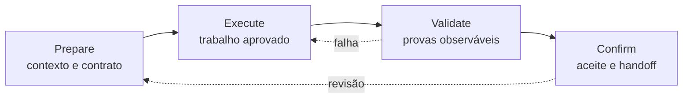

# PREVC

Um trabalho confiável passa por quatro movimentos simples: entender o pedido, fazer o trabalho aprovado, conferir o resultado e só então registrar a conclusão. PREVC dá nome a esse ciclo: **Prepare, Execute, Validate, Confirm**. A analogia é a de uma entrega de engenharia sênior: primeiro se define o contrato, depois se implementa, em seguida se testa contra evidência e, por fim, o responsável aceita ou devolve a entrega.

## O fluxo de quatro estágios



Os nomes intermediários do harness, como aprovação de plano, Judge e Refine, são controles dentro desse ciclo. Eles não criam novos estágios: a aprovação libera **Execute**, o Judge e o Refine fortalecem **Validate**, e a revisão do operador encerra **Confirm**.

### Prepare

Leia o pedido, as regras do projeto, o estado durável e o handoff anterior. Defina objetivo, escopo, não-escopo, critérios de aceite, risco, dependências e o comando de verificação. O plano fica aguardando aprovação quando a tarefa exige decisão do operador.

### Execute

Faça somente o trabalho aprovado. O scheduler pode distribuir unidades independentes, cada uma com dono, dependências e arquivos declarados. WIP=1 mantém uma unidade ativa por vez, mesmo quando há fan-out entre lanes.

### Validate

Colete provas que outra pessoa possa repetir: saída de comandos, critérios de aceite observáveis, estado atualizado e, quando aplicável, gate e revisão independente. Falha ou evidência ausente bloqueia o caminho; não é um sinal verde implícito.

### Confirm

O operador revisa a evidência, o resultado e o handoff. Confirmar registra a conclusão; pedir revisão retorna ao planejamento; abortar registra o motivo. Sem confirmação explícita e handoff durável, o ciclo não se declara concluído.

## A identidade de cada harness

O **OpenCode** fornece a metodologia e a referência do ciclo, além da continuidade entre sessões. O **Oh My Pi** fornece o motor nativo de **32 subagentes**, com fan-out paralelo e sharding para dividir trabalho independente. O caminho OMP é relevante quando uma tarefa aprovada tem lanes realmente independentes e a execução paralela reduz o tempo; para uma unidade pequena ou dependente, siga o ciclo com um agente.

## Iniciar e continuar

No OMP, uma solicitação pode iniciar o ciclo:

```text
/prevc prepare Adicionar endpoint de health check
```

Após a aprovação do plano:

```text
/prevc run
```

O estado PREVC e o handoff são duráveis. Isso permite que a próxima sessão retome o contrato e a evidência, em vez de confiar em memória de conversa.

## Regras essenciais

- Execute apenas o escopo aprovado.
- Mantenha WIP=1 por unidade ativa.
- Trate trabalho adjacente como `not_started`.
- Valide com evidência real e atual.
- Não confirme sem revisão do operador e handoff.

## Próximo passo

Veja [WIP=1](./wip-one) para a disciplina de foco ou [Evidência e Handoff](./evidence-and-handoff) para o formato das provas.
